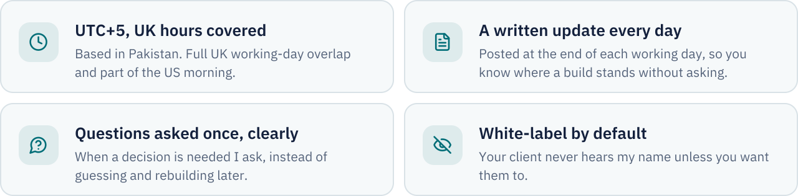

  <picture>
    <source media="(prefers-color-scheme: dark)" srcset="./assets/header-dark.svg">
    
  </picture>
  
    
  
  
  

## About

I've been shipping production web and mobile systems for a little over three years. Most of it is the part users don't see: multi-role marketplaces, payment and subscription logic, admin panels, and the database design underneath. Lately that includes Flutter apps that sit on top of backends I wrote.

Almost all of that code lives in private client repositories, so this page is the summary. The full case studies are on [my portfolio](https://rashidiya-portfolio.vercel.app/work).

## Selected work

  <a href="https://rashidiya-portfolio.vercel.app/work/autonect"><picture><source media="(prefers-color-scheme: dark)" srcset="./assets/work-autonect-dark.svg"></picture></a>
  <a href="https://rashidiya-portfolio.vercel.app/work/hareer-plus"><picture><source media="(prefers-color-scheme: dark)" srcset="./assets/work-hareer-plus-dark.svg"></picture></a>
   
  <a href="https://rashidiya-portfolio.vercel.app/work/chassis-doctor"><picture><source media="(prefers-color-scheme: dark)" srcset="./assets/work-chassis-doctor-dark.svg"></picture></a>
  <a href="https://rashidiya-portfolio.vercel.app/work/luumilo"><picture><source media="(prefers-color-scheme: dark)" srcset="./assets/work-luumilo-dark.svg"></picture></a>

<b>How each one was built</b>

 

**[Autonect](https://rashidiya-portfolio.vercel.app/work/autonect)**: iOS, Android and web admin. Buyers were phoning scrapyards one at a time to find a used part. Here a buyer types a registration number, the app pulls the vehicle details from the DVLA API, and the request reaches every matching supplier at once. Buyers, parts suppliers and auto electricians each work and pay differently, so I chose PostgreSQL over MongoDB to keep permissions and money movement enforced by the database. Stripe covers three revenue paths: supplier subscriptions, pay-per-lead credits and commission on sales.

**[Hareer+](https://rashidiya-portfolio.vercel.app/work/hareer-plus)**: backend and admin panel. Restaurants and clothing stores only look alike from the outside: one sells food with short fulfilment windows, the other sells stock with sizes and variants. I built two separate order flows, picked automatically by the store type a vendor chooses at onboarding. I owned the backend architecture and the admin panel, and wrote the technical spec the build ran from. NestJS with Redis and BullMQ for notifications, order events and settlement runs, hosted in AWS Milan for latency to North Africa, with LYPay and cash on delivery.

**[Chassis Doctor](https://rashidiya-portfolio.vercel.app/work/chassis-doctor)**: backend, admin panel and security audit. Before launch I audited Supabase row-level security across every table. Twenty critical holes came out of it, where data scoped to one user was reachable by any signed-in client. I fixed them in six sequential migrations rather than one large change, so each step could be reviewed and reversed on its own. The app is [live on Google Play](https://play.google.com/store/apps/details?id=com.chassisdoctor.app).

**[Luumilo](https://rashidiya-portfolio.vercel.app/work/luumilo)**: web and mobile. The AI assistant forgot everything between sessions, so parents re-explained their child's age each time they opened it. The fix was conversation memory on the backend: a 20-message sliding window, rolling summaries so older context survives, and carry-forward between sessions. I also built the React frontend, landing page and admin panel, and set up deployment on S3 and CloudFront with GitHub Actions.

## Stack

<table>
  <tr>
    <td width="110"><b>Backend</b></td>
    <td>
      <picture><source media="(prefers-color-scheme: dark)" srcset="https://skillicons.dev/icons?i=nodejs,nestjs,express,postgres,mongodb,prisma,redis&theme=dark"></picture>
       Plus BullMQ for background jobs
    </td>
  </tr>
  <tr>
    <td><b>Frontend</b></td>
    <td><picture><source media="(prefers-color-scheme: dark)" srcset="https://skillicons.dev/icons?i=react,nextjs,ts,tailwind&theme=dark"></picture></td>
  </tr>
  <tr>
    <td><b>Mobile</b></td>
    <td>
      <picture><source media="(prefers-color-scheme: dark)" srcset="https://skillicons.dev/icons?i=flutter,dart&theme=dark"></picture>
       Riverpod for state
    </td>
  </tr>
  <tr>
    <td><b>Infra</b></td>
    <td>
      <picture><source media="(prefers-color-scheme: dark)" srcset="https://skillicons.dev/icons?i=aws,supabase,githubactions,vercel,firebase&theme=dark"></picture>
       AWS: EC2, S3, RDS, CloudFront
    </td>
  </tr>
  <tr>
    <td><b>Services</b></td>
    <td>Stripe · RevenueCat · Firebase FCM · Twilio · OpenAI</td>
  </tr>
</table>

## How I work

<picture>
  <source media="(prefers-color-scheme: dark)" srcset="./assets/how-i-work-dark.svg">
  
</picture>

## Contact

<a href="mailto:rashidiyaoo7@gmail.com">
  <picture>
    <source media="(prefers-color-scheme: dark)" srcset="./assets/contact-dark.svg">
    
  </picture>
</a>

rashidiyaoo7@gmail.com · Rawalpindi, Pakistan (UTC+5) · I reply within one working day

